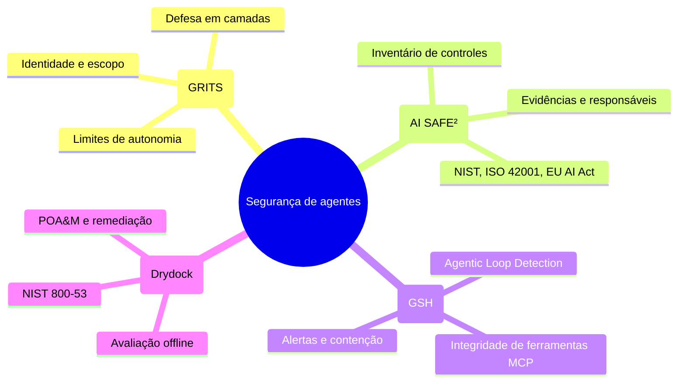

# AI Agent Security Architecture & Governance

Este repositório descreve a transição de um sistema de IA tradicional para um ecossistema de agentes com **Zero Trust** e **autonomia limitada** (*Bounded Autonomy*). Cada agente recebe identidade própria, contexto mínimo, ferramentas explicitamente permitidas e limites verificáveis. Nenhum agente é confiável por estar dentro da rede ou por ter sido iniciado pelo sistema.

O conteúdo é uma arquitetura de referência para aplicações como LexiQuest e Velobase. Os exemplos citam Next.js, tRPC, LangGraph, Prisma e Neon; devem ser adaptados ao ambiente real e não implicam que essas integrações já estejam implantadas.

## Navegação

| Área | Conteúdo | Resolve |
|---|---|---|
| [Frameworks](docs/frameworks/) | [GRITS](docs/frameworks/grits.md), [AI SAFE²](docs/frameworks/ai-safe2.md), [GSH](docs/frameworks/gsh.md), [Drydock](docs/frameworks/drydock.md) | Converte princípios de governança, compliance, detecção e auditoria em controles técnicos; fontes e status de validação estão em cada página. |
| [Arquitetura](docs/architecture/) | [Plano em 5 fases](docs/architecture/5-phase-plan.md), [Fluxo de comunicação](docs/architecture/agent-communication-flow.md) | Define sequência de implantação, fronteiras de confiança e decisões de autorização. |
| [Segurança](docs/security/) | [Registro de agentes](docs/security/agent-registry.md), [Matriz de permissões](docs/security/permissions-matrix.md), [Resposta a incidentes](docs/security/incident-response.md) | Mantém inventário, menor privilégio e procedimentos de contenção e recuperação. |
| [Checklist](docs/checklists/security-checklist.md) | Controles de implementação | Acompanha evidências e critérios de aceite antes da produção. |

## Princípios de uso

1. **Identidade por agente:** autentique o workload e valide sua identidade em cada chamada privilegiada.
2. **Autorização explícita:** autorize operações e recursos específicos; não exponha o ORM ou credenciais amplas ao modelo.
3. **Aprovação fora do modelo:** operações de alto impacto exigem política determinística e, quando aplicável, aprovação humana.
4. **Observabilidade segura:** registre ator, ferramenta, decisão e correlação sem armazenar segredos ou dados sensíveis desnecessários.
5. **Falha fechada:** indisponibilidade do serviço de política, identidade ou orçamento bloqueia a ação privilegiada.

## Status e validação

Este é um **modelo de arquitetura**, não uma declaração de conformidade nem evidência de controles implantados. As fontes primárias consultadas são [X-Scale-AI/GRITS](https://github.com/X-Scale-AI/GRITS) e [CyberStrategyInstitute/ai-safe2-framework](https://github.com/CyberStrategyInstitute/ai-safe2-framework). Os repositórios descrevem GRITS como 21 controles em cinco camadas Zero Trust, e AI SAFE² v3.1 como 161 controles mapeados a 32 frameworks. Esses números são declarações dos mantenedores, não validação independente.

Não foi identificado repositório primário correspondente ao **GSH** de detecção ou ao **Drydock** CLI de compliance descritos neste manual. Até que as fontes sejam confirmadas, essas páginas são requisitos de arquitetura, não descrição verificada de produtos. Registre versão, proprietário, data de revisão e evidências no ciclo de governança.
