# Plano de implantação em 5 fases

As fases são gates de capacidade, não apenas etapas de calendário. É possível executá-las incrementalmente por agente, mas nenhuma identidade deve receber acesso de produção antes de passar pelos gates de autorização, observabilidade e resposta.

```mermaid
%%{init: {'theme':'base','themeVariables': {'primaryColor':'#183b56','primaryTextColor':'#ffffff','primaryBorderColor':'#62c6a5','lineColor':'#62c6a5','secondaryColor':'#263238','tertiaryColor':'#6d4c41','background':'#111827','clusterBkg':'#17212b','clusterBorder':'#62c6a5'}}}%%
flowchart LR
  A["1 · Governança<br/>inventário, risco e donos"] --> G1{"Escopo e risco aprovados?"}
  G1 -->|Sim| B["2 · Identidade<br/>principal por agente e escopo mínimo"]
  G1 -->|Não| A
  B --> G2{"Autorização testada?"}
  G2 -->|Sim| C["3 · Detecção<br/>telemetria, loops e abuso de ferramentas"]
  G2 -->|Não| B
  C --> G3{"Alertas e bloqueios exercitados?"}
  G3 -->|Sim| D["4 · Compliance<br/>controles, evidências e POA&M"]
  G3 -->|Não| C
  D --> G4{"Lacunas e exceções com dono?"}
  G4 -->|Sim| E["5 · Resposta<br/>kill switch, revogação e recuperação"]
  G4 -->|Não| D
  E --> G5{"Exercício de incidente aprovado?"}
  G5 -->|Sim| LIVE["Produção com monitoramento contínuo"]
  G5 -->|Não| E
  LIVE -. "mudanças e revisão periódica" .-> A
  classDef phase fill:#183b56,stroke:#62c6a5,color:#fff,stroke-width:2px;
  classDef gate fill:#6d4c41,stroke:#ffd166,color:#fff;
  classDef done fill:#14532d,stroke:#86efac,color:#fff,stroke-width:2px;
  class A,B,C,D,E phase;
  class G1,G2,G3,G4,G5 gate;
  class LIVE done;
```

## Fase 1: Governança

- Inventarie agentes, modelos, ferramentas, dados, ambientes e responsáveis.
- Defina finalidade, risco, limites de autonomia, revisão humana e política de retenção.
- Classifique operações por impacto e reversibilidade; identifique ações que nunca podem ser autônomas.
- **Gate:** proprietário e Segurança aprovam escopo e risco residual antes da integração privilegiada.

## Fase 2: Identidade

- Atribua identidade distinta a cada agente/ambiente; não compartilhe credenciais humanas nem entre agentes.
- Valide principal no backend e derive contexto confiável do token/sessão; nunca aceite identidade declarada pelo prompt.
- Implemente autorização por operação, recurso e contexto; mantenha roles do banco separadas e limitadas.
- **Gate:** testes provam negação por padrão, expiração/revogação e isolamento entre agentes.

## Fase 3: Detecção

- Correlacione requisição, execução LangGraph, chamada de ferramenta e operação de domínio por trace ID.
- Implemente limites de iteração, duração, custo, taxa e repetição; monitore mudanças no catálogo MCP.
- Gere alertas acionáveis e valide-os com exercícios de abuso controlados.
- **Gate:** alertas chegam ao responsável e o fluxo privilegiado pode ser bloqueado sem depender do modelo.

## Fase 4: Compliance

- Mapeie riscos e obrigações para controles selecionados de NIST AI RMF, ISO/IEC 42001, EU AI Act e NIST SP 800-53, conforme aplicabilidade.
- Mantenha controles com dono, teste, evidência, frequência e status; abra POA&M para lacunas.
- **Gate:** revisão independente confirma evidências, exceções e riscos residuais; não confundir documento com conformidade.

## Fase 5: Resposta

- Implemente kill switch por agente, ferramenta e ambiente; revogue credenciais e pause execuções.
- Mantenha procedimento de rollback/recovery testado, com backups e estratégia compatível com PITR e consistência dos dados.
- Exercite cenário de alucinação com efeito colateral, credencial comprometida, ferramenta envenenada e abuso de custo.
- **Gate:** exercício demonstra contenção, preservação de evidências, recuperação e aprovação de retorno ao serviço.

## Operação contínua

Repita a avaliação quando houver mudança de modelo, prompt de sistema, ferramenta, schema, permissões, fluxo de dados, região ou finalidade. Revise periodicamente acessos e orçamento, teste o kill switch e feche POA&Ms com evidência retestada.