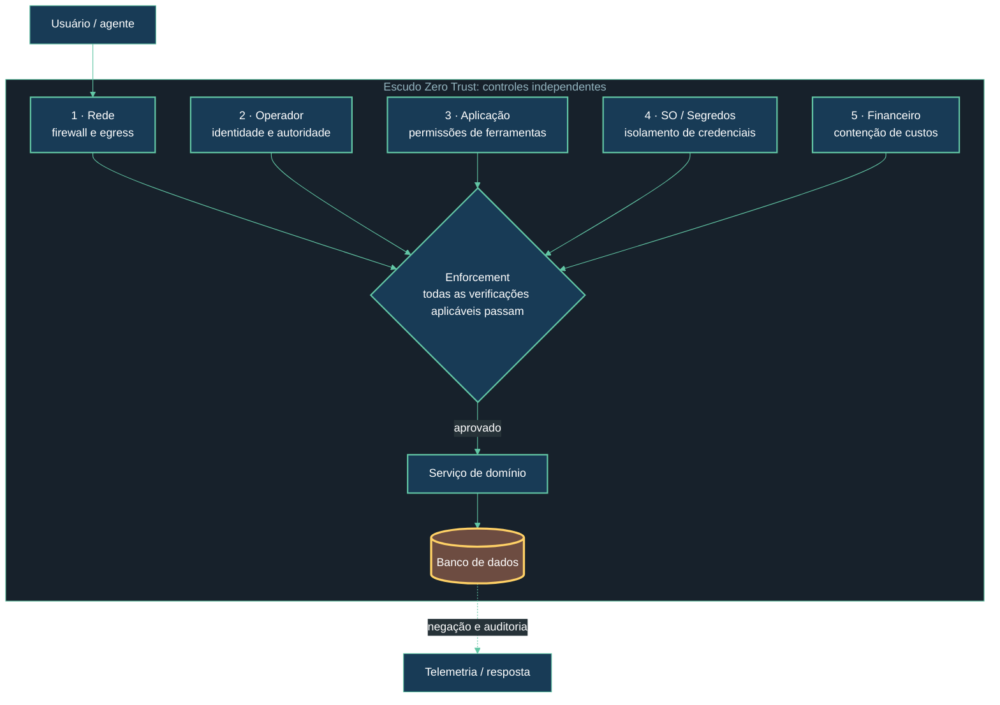

# GRITS: governança e defesa em camadas

## Objetivo

O [repositório primário GRITS](https://github.com/X-Scale-AI/GRITS) define **Governance, Risk, Integrity, Trust, Security** como seus cinco pilares e publica um catálogo de **21 controles** sobre cinco camadas Zero Trust. Este manual usa esses conceitos como base e traduz parte deles em controles de implementação; não reproduz o catálogo completo nem afirma conformidade com ele. Consulte também o [grits-agent-scanner](https://github.com/X-Scale-AI/grits-agent-scanner) para a implementação de avaliação citada pelo mantenedor.

GRITS é um padrão de governança/avaliação, não uma biblioteca que por si só impõe autorização no runtime. Cada controle precisa ser implementado pelo serviço que detém a autoridade. O objetivo aqui é retirar do agente o acesso implícito: cada identidade, ferramenta e operação recebe escopo mínimo, prazo e limite explícitos.

## Camadas de defesa

| Camada | Controles concretos | Evidência esperada |
|---|---|---|
| Rede | Segmentação por ambiente; egress allowlist; TLS; banco sem endpoint público quando possível; políticas de conexão entre serviços. | Regras de rede revisadas, inventário de endpoints e testes de conectividade negativa. |
| Operador | SSO/MFA para administração; RBAC; aprovação de ações sensíveis; contas de serviço não compartilhadas; trilha de alterações de políticas. | Matriz de responsáveis, aprovações vinculadas a mudanças e logs de acesso administrativo. |
| Aplicação | Autenticação de workload; autorização em cada chamada; allowlist de ferramentas; validação de entrada/saída; idempotência e limites de taxa. | Testes de autorização, configuração versionada e eventos de decisão correlacionáveis. |
| SO e segredos | Containers sem privilégios; imagem fixada e assinada; filesystem somente leitura quando viável; segredos em cofre com rotação; nunca inserir chaves no prompt. | SBOM, resultados de varredura, política de execução e registros de rotação sem valor secreto. |
| Financeiro | Orçamento de tokens por agente e período; limites de custo e taxa; alertas de anomalia; teto de gastos e procedimento de corte. | Métricas por agente, alertas exercitados e teste documentado de bloqueio ao exceder orçamento. |

## Modelo de defesa

As cinco camadas do GRITS são domínios de controle independentes, não etapas sequenciais de uma requisição. Uma falha de aplicação não deve permitir que o agente alcance diretamente o banco; uma credencial vazada não deve ser suficiente para cruzar as demais barreiras. Os cinco pilares do framework (Governance, Risk, Integrity, Trust, Security) explicam por que os controles existem; as camadas identificam onde aplicá-los.

O diagrama representa dependências de controle, não uma sequência única de rede. Na implementação, faça enforcement no ponto que detém a autoridade: API para identidade e política, runtime para sandbox/orçamento e banco para grants e isolamento.
O diagrama representa domínios de controle distintos, não uma sequência única de rede. Na implementação, faça enforcement no ponto que detém a autoridade: API para identidade e política, runtime para sandbox/orçamento e banco para grants e isolamento.

O catálogo oficial relaciona cada controle a um ou mais pilares e camadas e inclui expectativa pass/fail. Use a versão do catálogo como referência no assessment, em vez de tratar esta síntese como substituta dos controles oficiais.

## Aplicação de referência

- **Next.js / tRPC:** derive o principal de uma sessão ou credencial de workload verificada; não aceite `agentId` informado pelo cliente como prova de identidade. Use procedimentos protegidos e autorização por recurso.
- **LangGraph:** associe limites de iteração, timeout, orçamento e allowlist ao perfil do agente. O estado do grafo não substitui autorização.
- **Prisma / Neon:** exponha funções de domínio estreitas. Evite entregar ao agente um cliente Prisma genérico ou credencial de banco; use roles distintas e permissões mínimas.
- **Operações críticas:** separe proposta de execução; exija aprovação humana ou política de dupla validação para ações irreversíveis.

## Critérios de aceite

- Uma chamada sem identidade ou com escopo expirado é negada.
- Um agente não consegue executar ação fora da matriz de permissões mesmo que o modelo a solicite.
- A falha do avaliador de política não resulta em autorização permissiva.
- Exceder orçamento ou limite de iterações encerra o fluxo e produz evento auditável.
- A rotação/revogação de uma credencial invalida o acesso sem depender de reinício manual do agente.